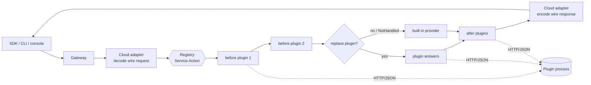
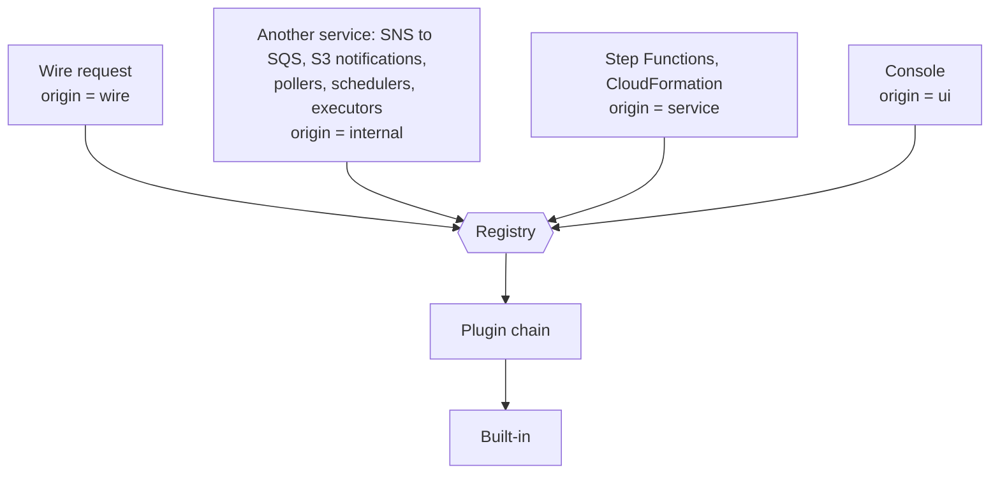
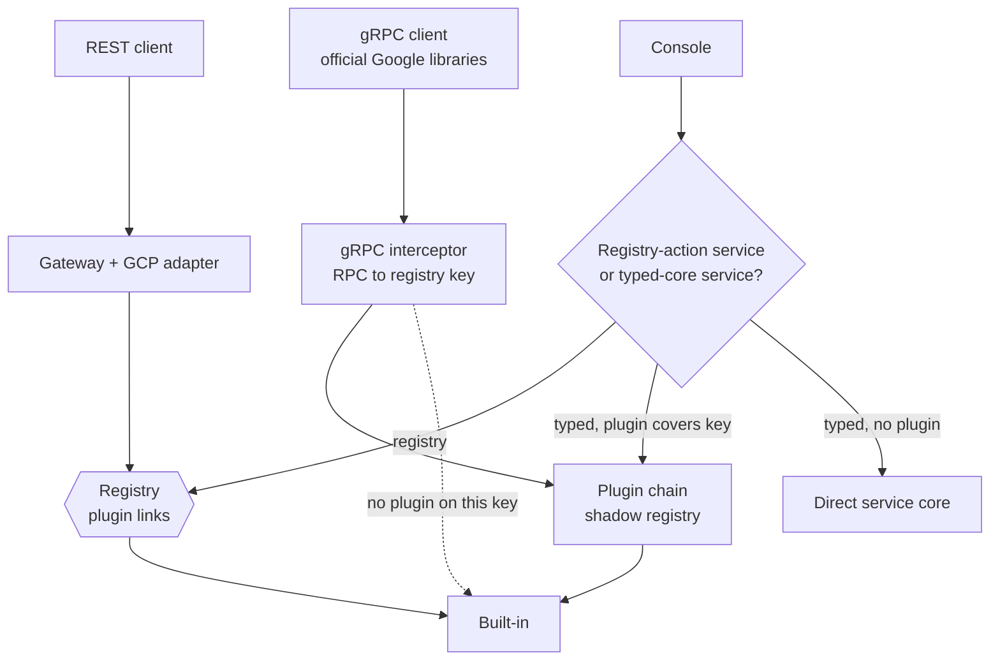
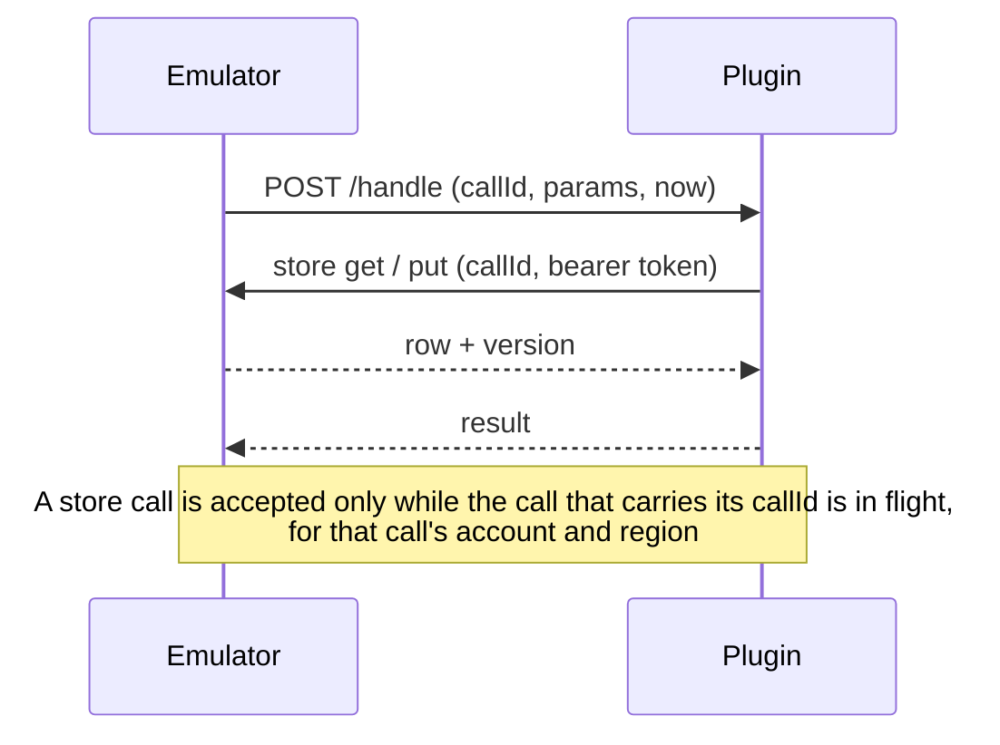

# Plugins

A plugin changes how a running `jaiscloud-aws` or `jaiscloud-gcp` answers API calls, without forking
the emulator. A plugin can:

- **audit or rewrite** calls (`before` / `after`),
- **replace** one action or a whole service (`replace`), and
- keep its own state in jaiscloud's stores, so `reset`, `export` / `import`, snapshots and the frozen
  clock (`POST /_jaiscloud/clock`) cover it with no plugin code.

A plugin is a small HTTP/JSON server you run next to the emulator. It is written against the Go SDK
([sdk/README.md](../sdk/README.md)), or in any language that speaks the wire format
([sdk/wire.go](../sdk/wire.go)).

With no plugin configured nothing changes: every plugin code path is dormant, and a run without
plugins behaves as it did before plugins existed.

- [Quick start](#quick-start)
- [How it works](#how-it-works)
- [Every caller goes through the plugin](#every-caller-goes-through-the-plugin)
- [GCP: REST, gRPC and the console](#gcp-rest-grpc-and-the-console)
- [Configuration](#configuration)
- [State](#state)
- [Seeing what is loaded](#seeing-what-is-loaded)
- [Limitations](#limitations)
- [Troubleshooting](#troubleshooting)
- [Tests](#tests)

---

## Quick start

```bash
mkdir acme-audit && cd acme-audit
go mod init example.com/acme-audit
go get github.com/jaisrajms/jaiscloud/sdk
```

```go
package main

import (
	"context"
	"log"

	"github.com/jaisrajms/jaiscloud/sdk"
)

func main() {
	m := sdk.NewMux("acme-audit", "0.1.0")
	m.Before("aws", "sqs", "SendMessage", func(ctx context.Context, c *sdk.Call) (sdk.Result, error) {
		log.Printf("SendMessage to %v at %s", c.Req.Params["QueueUrl"], c.Req.Now)
		return sdk.Result{}, nil // carry on to the built-in
	})
	log.Fatal(sdk.ListenAndServe(":9100", m)) // ":9100" means 127.0.0.1:9100
}
```

```bash
go run .                                          # terminal 1
jaiscloud-aws start --plugin http://127.0.0.1:9100   # terminal 2
```

The SDK is a separate Go module inside this repo, so to run an example from a checkout use
`cd sdk && go run ./examples/audit`.

Complete examples: [sdk/examples/audit](../sdk/examples/audit/main.go) (AWS) and
[sdk/examples/gcp-audit](../sdk/examples/gcp-audit/main.go) (GCP, REST and gRPC).

Until an `sdk/v0.x.y` tag is published, `go get` cannot resolve the module. Use a checkout instead:
`go mod edit -replace github.com/jaisrajms/jaiscloud/sdk=/path/to/jaiscloud/sdk`.

---

## How it works

A plugin claims **routes**. A route is a cloud, a wire service (`sqs`, `pubsub`, …), a list of actions
(or `"*"` for the whole service) and a **mode**:

| Mode | What the plugin does |
|---|---|
| `before` | Runs ahead of the built-in. Returns a patch over the params, or an answer or error that stops the call. |
| `after` | Runs once the built-in has answered. Sees the result or the error and may replace either. |
| `replace` | Answers instead of the built-in. `NotHandled` hands the call back to the built-in. |

Every service in the emulator is reached through one table, the provider **registry**, keyed by
`Service.Action` (for example `Queue.SendMessage`). A plugin adds links to that table. Nothing else in
the emulator is aware of plugins.



Rules worth knowing:

- **Order.** Plugins listed first (`--plugin` order) run outermost. At most one `replace` wins a key;
  two plugins replacing the same key is a startup error.
- **The adapter encodes the answer.** A plugin returns plain data (`Data`) and the built-in codec writes
  it in the cloud's wire format, so field names must match the real service.
- **Fail-closed.** A plugin that is down or failing never silently falls back to the built-in. See
  [Troubleshooting](#troubleshooting).
- **Startup only.** Plugins are loaded once at start. There is no hot reload or unload.
- **A misspelled action is an error.** `before` / `after` on an action that does not exist fails startup
  instead of never firing.

---

## Every caller goes through the plugin

If a plugin overrides a key, **every** part of the emulator that makes that call uses the plugin, as if
the built-in did not exist. The request carries `Req.Origin` so a plugin can tell callers apart, but it
does not have to.



| Origin | Callers |
|---|---|
| `wire` | A client request on the API port |
| `internal` | One service calling another: delivery (SNS, S3 and EventBridge to SQS, Lambda or EventBridge), the Lambda event-source pollers, log writes from executors, KMS use by Secrets Manager and SSM, Pub/Sub publishing for GCP notifications, and similar |
| `service` | Step Functions task states and CloudFormation resource handlers, with the parameters a client would send |
| `ui` | The console |

An internal call is an ordinary client call. For example, when the emulator writes an object to a bucket
that does not exist, `PutObject` answers `NoSuchBucket` and the emulator then calls `CreateBucket` and
`PutObject`, exactly as an agent would. The full per-service list, and what a plugin that replaces a
service has to answer for its internal callers, is in [sdk/README.md](../sdk/README.md#overriding-a-service-covers-internal-flows).

Two guard tests keep this true as the code changes: the architecture tests in `cmd/jaiscloud-aws` and
`cmd/jaiscloud-gcp` fail when a new link from one service to another bypasses the registry.

---

## GCP: REST, gRPC and the console

`jaiscloud-gcp` is reached over REST and over gRPC, and has a console. All three reach the **same key**.



**REST.** Providers already dispatch through the registry; a plugin sees the REST shape (path
parameters plus `body`).

**gRPC.** Each RPC is mapped to the registry key of its REST twin by running the proto's
`google.api.http` rule through the GCP adapter's own route detector. The plugin sees the
**gRPC-native shape under the same key**: `Req.Transport == "grpc"` and `Params` (and the response) are
the protojson form of the RPC messages (camelCase, int64 as strings, enums by name). A call whose key no
plugin touches goes straight to the normal gRPC handler, unchanged. A plugin written for one shape says
so and is skipped for the other:

```go
m := sdk.NewMux("acme", "0.1.0").Transports("rest") // "rest", "grpc", or both (the default)
```

**Console.** Services whose console calls registry actions go through `Registry.Dispatch` with origin
`ui`. Services whose console works on typed structs (Scheduler, Tasks, Workflows, Cloud Run, Functions,
Eventarc, Dataproc, Managed Kafka, Datastore, Resource Manager) go through the plugin chain only when a
plugin covers the key: the call is turned into the REST request a client would send, the REST built-in
sits innermost, and the answer is turned back into the console's model.

**GCP services calling each other** (Storage notifications to Pub/Sub, Eventarc and Functions plumbing,
Dataproc output to Storage, Metastore attachment checks, Cloud Run delivery) go through
`internal/gcp/seams`, which are ordinary registry clients, so a plugin that replaces Pub/Sub also sees
the emulator's own publishes. If a service is switched off with `--transport-overrides X=none`, the
seams still reach its built-in provider, so dependent services keep working.

---

## Configuration

Flags exist on both binaries. Each has an environment variable.

| Flag | Env var | Default | Description |
|---|---|---|---|
| `--plugin` | `JAISCLOUD_PLUGINS` | — | Plugin to load, `http://host:port`. Repeatable (comma-separated in the env var). Order is precedence order |
| `--plugin-timeout` | `JAISCLOUD_PLUGIN_TIMEOUT` | `10s` | Timeout of each HTTP attempt to a plugin |
| `--plugin-wait` | `JAISCLOUD_PLUGIN_WAIT` | `2m` | How long to keep retrying an unreachable plugin at startup before failing |
| `--plugin-retry` | `JAISCLOUD_PLUGIN_RETRY` | `30s` | How long to retry an unreachable plugin during a request before answering 503 |
| `--plugin-secret` | `JAISCLOUD_PLUGIN_SECRET` | — | Shared secret sent as a bearer token (pair with `sdk.WithSecret`) |
| `--plugin-callback-url` | `JAISCLOUD_PLUGIN_CALLBACK_URL` | `http://127.0.0.1:<port>` | URL a plugin uses to reach the emulator's store. Set it when the plugin runs in another container |

Nothing loads unless `--plugin` (or the env var) names it. There is no directory scan and no default
plugin path.

**Security.** Loading a plugin is trust: there is no sandbox and no signature check. By default the
SDK server binds loopback only and refuses browser requests (anything with an `Origin` header) and
non-JSON POSTs. To listen on another interface, say so and set a secret on both sides:

```go
sdk.ListenAndServe("0.0.0.0:9100", m, sdk.WithSecret(os.Getenv("PLUGIN_SECRET")))
```

```bash
jaiscloud-aws start --plugin http://plugin:9100 --plugin-secret "$PLUGIN_SECRET"
```

---

## State

`c.Store` keeps rows per `(kind, id)` in the emulator's own store, under the type
`plugin:<name>:<kind>`. Because they are ordinary rows, `reset`, `export` / `import`, named snapshots
and the file or PostgreSQL backends cover them with no plugin code.



- Every row has a `Version`. `PutIf(…, ifVersion)` writes only if the version still matches (`0` means
  "must not exist") and returns `sdk.ErrConflict` otherwise. `Put` is last-writer-wins.
- Use `c.Req.Now` for time, never `time.Now()`. That is what makes a frozen clock work.
- After `reset`, `import` or a snapshot revert, the emulator calls the plugin's `HandleLifecycle`
  (`reset` / `restore`). Drop any cache you keep.

---

## Seeing what is loaded

- **Startup log.** One `plugin loaded` line per plugin.
- **Doctor.** `GET /_jaiscloud/doctor` has a `plugins` section (name, version, transport, URL, ABI,
  routes). It is absent when no plugin is loaded.
- **Metrics.** With `--metrics`, `jaiscloud_plugin_calls_total{plugin,phase,outcome}` and
  `jaiscloud_plugin_call_seconds{plugin,phase}` appear. They are registered only when a plugin is
  loaded, and no existing metric changes.
- **Conformance.** A service or action a plugin overrides is outside every fidelity claim for that
  process: the fidelity matrix and the conformance suites describe the built-ins only.

---

## Limitations

### All clouds

| Limit | Detail |
|---|---|
| Out-of-process only | A plugin is an HTTP/JSON process. In-process Go (`.so`) plugins, new services, new REST path routes and a raw-response escape hatch are designed but not implemented. The SDK is experimental (ABI 1) |
| JSON only | Everything crosses as JSON. Bytes arrive as `{"$base64": "…"}` under `_` keys. A value that cannot be JSON (a stream, such as a built-in `GetObject` body) is never shown to the plugin and is always preserved, so such a response can be **observed** with `after` but not replaced (`501 PluginUnsupportedPayload`). A wire `GetObject` cannot be replaced by an out-of-process plugin |
| Payload size | A request or response over 32 MiB once encoded is refused with `PluginUnsupportedPayload` before it reaches the plugin; an S3 `PutObject` is therefore limited to about 24 MiB on a route with a plugin |
| Fail-closed | A plugin that is down for longer than `--plugin-retry` makes the keys it covers fail with `503 PluginUnavailable`. The built-in is never used as a fallback |
| Startup only | No hot reload or unload; restart the emulator to change plugins |
| Trust | No sandbox and no signature check. A plugin can see and change every call on its routes |
| Clock | `POST /_jaiscloud/reset` and `/import` put the clock back to real time |
| Background work | Other services' pollers and schedulers call through the registry. A plugin that replaces a service owns that service's own background behaviour (expiry, scheduling, alarms). Test hooks (`eb-tick`, `ttl-sweep`, `cw-evaluate`, `firehose/flush`, and the GCP scheduler, tasks and monitoring ticks) run the built-in's pass, then send the plugin a `tick:<service>` lifecycle event |
| Admin API | `/_jaiscloud/*` endpoints are not plugin-routable |
| Emulator-only helpers | Console helpers that are not API actions (for example SQS "peek messages", the GCP "observed projects" list, the Functions delivery log) read the built-in's own state |
| Flows that do not exist | A flow the emulator does not implement (for example EMR on EC2 log forwarding) is never seen by a plugin |
| Before patches are shallow | `Result.Params` replaces whole top-level keys. To change one field of a nested object (REST's `body`, a map of labels), return a copy of the object with that field edited |

### GCP

| Limit | Detail |
|---|---|
| RPCs with no REST twin | These cannot be intercepted over gRPC: Cloud Storage v2 gRPC entirely, Pub/Sub snapshots and `StreamingPull`, Firestore `Listen` / `Write`, Cloud Logging tail, Resource Manager search and move, and several GKE and Firestore Admin methods. The list is recorded in `internal/gcp/grpcplugin/testdata/coverage.golden` |
| Streaming RPCs | A plugin is consulted once, at stream open. `before` may refuse the stream, `after` runs at once with an empty answer, `replace` is refused. Client and bidirectional streams show an empty request at open |
| Long-running operations | The generic `google.longrunning.Operations` RPCs are not intercepted: a plugin cannot be asked about another service's operation |
| Functions v1 and v2 | The two versions' RPCs share one key. Their request messages differ in shape, so a plugin tells them apart by the fields it receives |
| gRPC before patches | A `before` patch is applied to the request message only |
| Console shape | With a plugin in the path, the console shows the REST rendering of a typed-core resource, so fields the REST shape does not carry (a function's stored source hash, a Dataproc cluster's region) are absent or derived. A key no plugin covers keeps the direct path and is unchanged |
| Console build | The console only builds with `-tags ui` and the frontend assets, so it has no end-to-end test with plugins; the guard tests cover that every service is routed |
| Seam differences | A Pub/Sub dead-letter forward does not re-enter the delivery engine (it is marked `NoDispatchMeta`). Cloud Run delivery headers are canonicalised like any HTTP request (`ce-id` becomes `Ce-Id`). A seam's bucket create with no project uses the configured default project. Bytes between Storage and its callers travel in-process, so an out-of-process plugin can observe or wrap but not replace an object stream |
| Not API calls | The event bus, Functions-to-Eventarc trigger plumbing, the async-operation lookup, and the executors and engines are not API calls and stay direct. They are listed with reasons in `cmd/jaiscloud-gcp/architecture_test.go` |

---

## Troubleshooting

| Symptom | Cause and fix |
|---|---|
| Emulator will not start, error names a plugin address | The plugin was not reachable within `--plugin-wait`. Start it first, or raise the wait |
| `503 PluginUnavailable` / `PluginTimeout` | The plugin is down or slower than `--plugin-timeout` / `--plugin-retry`. The built-in is not used as a fallback |
| `500 PluginPanic` naming a plugin | A panic in the emulator's plugin seam. A panic inside your own process is yours to recover (the SDK server does and answers 500, reported as `PluginProtocolError`) |
| `501 PluginUnsupportedPayload` | The call carries a stream or more than 32 MiB. See [Limitations](#all-clouds) |
| Startup error about a misspelled action | `before` / `after` named an action that does not exist for that service |
| Startup error about two replacers | Two plugins both `replace` the same key. Narrow one of them |
| Plugin restarted and calls fail once | The plugin answers `409 not_initialized` until it receives `/init`; the emulator re-sends it and retries |
| My gRPC plugin receives odd JSON | Params are protojson under gRPC. Declare `Transports("rest")` to skip gRPC, or read `Req.Transport` |
| A frozen clock is ignored | Use `c.Req.Now`, not `time.Now()` |

An unreachable plugin does not lose data for the AWS event-source pollers: they back off from 1 s to
30 s, count nothing against the mapping, send nothing to a dead-letter destination and delete nothing,
so messages return after their visibility timeout.

---

## Tests

```bash
make test-sdk        # SDK unit tests
make test-plugins    # SDK tests + end-to-end against the real binaries (tag: plugin_e2e)
go test -race ./internal/pluginhost/ ./internal/gcp/grpcplugin/ ./internal/gcp/seams/
```

End-to-end tests are in [tests/plugins](../tests/plugins): AWS before / after / replace, internal flows,
and for GCP the REST and gRPC shapes under one key, streaming, seams, and a matrix over services.
