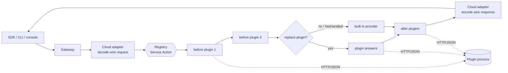
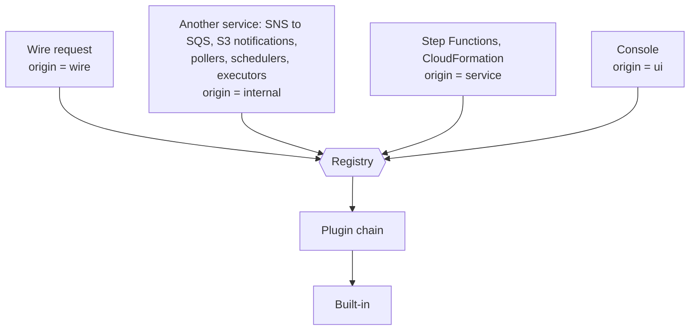
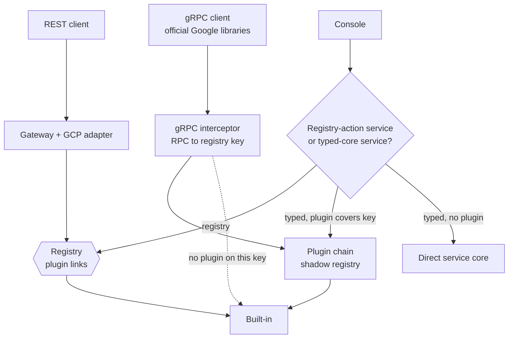
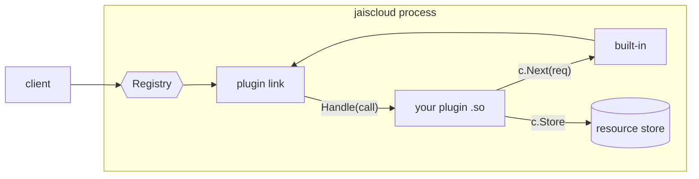
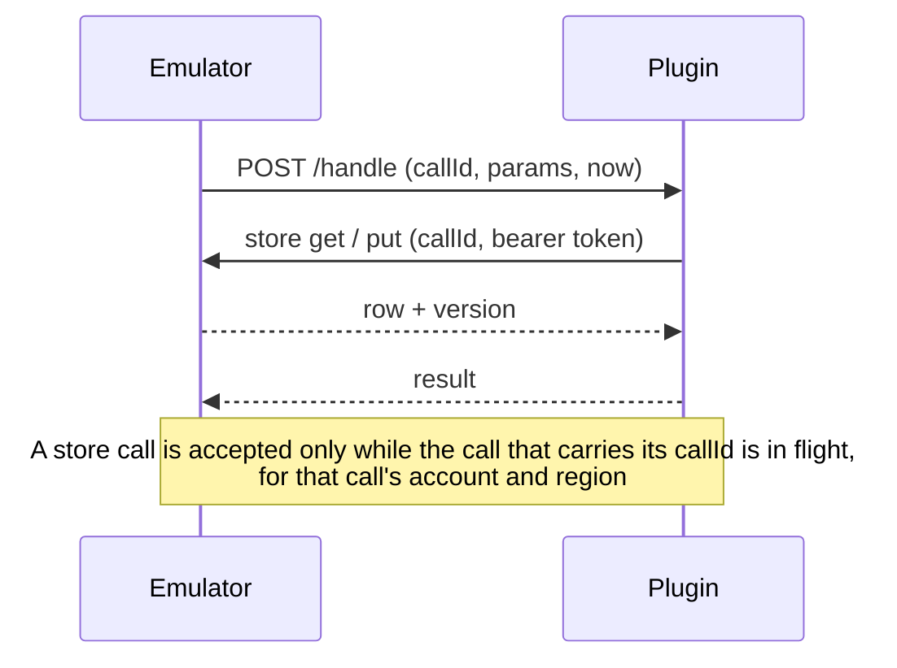

# Plugins

A plugin changes how a running `jaiscloud-aws` or `jaiscloud-gcp` answers API calls, without forking
the emulator. A plugin can:

- **audit or rewrite** calls (`before` / `after`),
- **replace** one action or a whole service (`replace`), and
- keep its own state in jaiscloud's stores, so `reset`, `export` / `import`, snapshots and the frozen
  clock (`POST /_jaiscloud/clock`) cover it with no plugin code.

A plugin comes in two forms, with the same contract (`Handle`, the same modes, the same state):

- **Out-of-process**: a small HTTP/JSON server you run next to the emulator, written against the Go SDK
  ([sdk/README.md](../sdk/README.md)) or in any language that speaks the wire format
  ([sdk/wire.go](../sdk/wire.go)). It works with every release.
- **In-process**: Go code compiled to a shared library and loaded into the emulator's own process. It
  can wrap the built-in, answer with streams and keep state in memory. It needs a plugin-capable build
  of the emulator. See [In-process plugins](#in-process-plugins).

With no plugin configured nothing changes: every plugin code path is dormant, and a run without
plugins behaves as it did before plugins existed.

- [Quick start](#quick-start-out-of-process)
- [Choosing a layer](#choosing-a-layer)
- [How it works](#how-it-works)
- [Every caller goes through the plugin](#every-caller-goes-through-the-plugin)
- [GCP: REST, gRPC and the console](#gcp-rest-grpc-and-the-console)
- [In-process plugins](#in-process-plugins)
- [Configuration](#configuration)
- [State](#state)
- [Seeing what is loaded](#seeing-what-is-loaded)
- [Limitations](#limitations)
- [Troubleshooting](#troubleshooting)
- [Tests](#tests)

---

## Quick start (out-of-process)

```bash
mkdir acme-audit && cd acme-audit
go mod init example.com/acme-audit
go get github.com/jaisrajms/jaiscloud/sdk
```

```go
package main

import (
	"context"
	"log"

	"github.com/jaisrajms/jaiscloud/sdk"
)

func main() {
	m := sdk.NewMux("acme-audit", "0.1.0")
	m.Before("aws", "sqs", "SendMessage", func(ctx context.Context, c *sdk.Call) (sdk.Result, error) {
		log.Printf("SendMessage to %v at %s", c.Req.Params["QueueUrl"], c.Req.Now)
		return sdk.Result{}, nil // carry on to the built-in
	})
	log.Fatal(sdk.ListenAndServe(":9100", m)) // ":9100" means 127.0.0.1:9100
}
```

```bash
go run .                                          # terminal 1
jaiscloud-aws start --plugin http://127.0.0.1:9100   # terminal 2
```

The SDK is a separate Go module inside this repo, so to run an example from a checkout use
`cd sdk && go run ./examples/audit`.

Complete examples: [sdk/examples/audit](../sdk/examples/audit/main.go) (AWS) and
[sdk/examples/gcp-audit](../sdk/examples/gcp-audit/main.go) (GCP, REST and gRPC).

Until an `sdk/v0.x.y` tag is published, `go get` cannot resolve the module. Use a checkout instead:
`go mod edit -replace github.com/jaisrajms/jaiscloud/sdk=/path/to/jaiscloud/sdk`.

---

## Choosing a layer

| You want to | Use |
|---|---|
| Audit, rewrite or block calls; add behaviour; any language; run it anywhere the emulator runs | **Out-of-process** (`--plugin http://...`) |
| Wrap the built-in and change its answer; answer an S3 read with a stream; avoid the round trip; keep large state in memory | **In-process** (`--plugin so:<path>`) |

Both can be loaded together and share one precedence order. In-process needs a cgo build of the emulator
on linux or darwin and a plugin built to match it; out-of-process needs nothing special.

---

## How it works

A plugin claims **routes**. A route is a cloud, a wire service (`sqs`, `pubsub`, …), a list of actions
(or `"*"` for the whole service) and a **mode**:

| Mode | What the plugin does |
|---|---|
| `before` | Runs ahead of the built-in. Returns a patch over the params, or an answer or error that stops the call. |
| `after` | Runs once the built-in has answered. Sees the result or the error and may replace either. |
| `replace` | Answers instead of the built-in. `NotHandled` hands the call back to the built-in. |

Every service in the emulator is reached through one table, the provider **registry**, keyed by
`Service.Action` (for example `Queue.SendMessage`). A plugin adds links to that table. Nothing else in
the emulator is aware of plugins.



Rules worth knowing:

- **Order.** Plugins listed first (`--plugin` order) run outermost. At most one `replace` wins a key;
  two plugins replacing the same key is a startup error.
- **The adapter encodes the answer.** A plugin returns plain data (`Data`) and the built-in codec writes
  it in the cloud's wire format, so field names must match the real service.
- **Fail-closed.** A plugin that is down or failing never silently falls back to the built-in. See
  [Troubleshooting](#troubleshooting).
- **Startup only.** Plugins are loaded once at start. There is no hot reload or unload.
- **A misspelled action is an error.** `before` / `after` on an action that does not exist fails startup
  instead of never firing.

---

## Every caller goes through the plugin

If a plugin overrides a key, **every** part of the emulator that makes that call uses the plugin, as if
the built-in did not exist. The request carries `Req.Origin` so a plugin can tell callers apart, but it
does not have to.



| Origin | Callers |
|---|---|
| `wire` | A client request on the API port |
| `internal` | One service calling another: delivery (SNS, S3 and EventBridge to SQS, Lambda or EventBridge), the Lambda event-source pollers, log writes from executors, KMS use by Secrets Manager and SSM, Pub/Sub publishing for GCP notifications, and similar |
| `service` | Step Functions task states and CloudFormation resource handlers, with the parameters a client would send |
| `ui` | The console |

An internal call is an ordinary client call. For example, when the emulator writes an object to a bucket
that does not exist, `PutObject` answers `NoSuchBucket` and the emulator then calls `CreateBucket` and
`PutObject`, exactly as an agent would. The full per-service list, and what a plugin that replaces a
service has to answer for its internal callers, is in [sdk/README.md](../sdk/README.md#overriding-a-service-covers-internal-flows).

Two guard tests keep this true as the code changes: the architecture tests in `cmd/jaiscloud-aws` and
`cmd/jaiscloud-gcp` fail when a new link from one service to another bypasses the registry.

---

## GCP: REST, gRPC and the console

`jaiscloud-gcp` is reached over REST and over gRPC, and has a console. All three reach the **same key**.



**REST.** Providers already dispatch through the registry; a plugin sees the REST shape (path
parameters plus `body`).

**gRPC.** Each RPC is mapped to the registry key of its REST twin by running the proto's
`google.api.http` rule through the GCP adapter's own route detector. The plugin sees the
**gRPC-native shape under the same key**: `Req.Transport == "grpc"` and `Params` (and the response) are
the protojson form of the RPC messages (camelCase, int64 as strings, enums by name). A call whose key no
plugin touches goes straight to the normal gRPC handler, unchanged. A plugin written for one shape says
so and is skipped for the other:

```go
m := sdk.NewMux("acme", "0.1.0").Transports("rest") // "rest", "grpc", or both (the default)
```

**Console.** Services whose console calls registry actions go through `Registry.Dispatch` with origin
`ui`. Services whose console works on typed structs (Scheduler, Tasks, Workflows, Cloud Run, Functions,
Eventarc, Dataproc, Managed Kafka, Datastore, Resource Manager) go through the plugin chain only when a
plugin covers the key: the call is turned into the REST request a client would send, the REST built-in
sits innermost, and the answer is turned back into the console's model.

**GCP services calling each other** (Storage notifications to Pub/Sub, Eventarc and Functions plumbing,
Dataproc output to Storage, Metastore attachment checks, Cloud Run delivery) go through
`internal/gcp/seams`, which are ordinary registry clients, so a plugin that replaces Pub/Sub also sees
the emulator's own publishes. If a service is switched off with `--transport-overrides X=none`, the
seams still reach its built-in provider, so dependent services keep working.

---

## In-process plugins

An in-process plugin is Go code compiled to a shared library (`.so`) and loaded **into the emulator's
own process** with `--plugin so:<path>`. It uses the same SDK and the same `Handle` contract as an
HTTP plugin, and it can do what a separate process cannot:

| | In-process (`.so`) | Out-of-process (HTTP) |
|---|---|---|
| Wrap the built-in | `c.Next(ctx, req)` runs the rest of the chain, so a `replace` can change the request, call the built-in and change its answer | Not available; use `before` / `after` / `NotHandled` |
| Streams and bytes | Params and responses hold the emulator's own values (`[]byte`, `io.Reader`), so it can read an S3 upload and **replace a `GetObject` answer** | JSON only; a stream can be observed but not replaced |
| Speed | A function call | An HTTP round trip with JSON encoding |
| Own state in memory | `sdk.Stateful`: reset, export/import and snapshots include it | Must use `c.Store` |
| `ResourceID` | `c.ResourceID(type, name)` formats an ARN or resource name like the emulator does | Format your own |
| Platforms | linux and darwin, **built with cgo** | Everything, any language |
| Isolation | Shares the emulator's process: a panic in a goroutine the plugin starts, a deadlock or `os.Exit` takes the emulator down | A separate process |
| Setup | A plugin-capable emulator build and a matching plugin build | `go run .` |

Choose in-process when you need to wrap the built-in, answer with a stream, or avoid the round trip.
Otherwise an HTTP plugin is simpler and safer.



### What you need

Go loads a plugin only into a binary that was built by the **same Go toolchain, with the same flags, and
the same source for every package they share**. The released archives are static builds without cgo, so
**they cannot load a `.so`**. In-process plugins need two things built to match:

1. **A plugin-capable emulator**: `CGO_ENABLED=1` on linux or darwin, built with `-trimpath`.
   `make build-plugins` (or `build-plugins-aws` / `build-plugins-gcp`) produces
   `jaiscloud-aws-plugins` and `jaiscloud-gcp-plugins`, or use the container image (below).
2. **Your plugin, built to match**: the same Go version, `-trimpath`, `CGO_ENABLED=1`, and the same
   SDK source, as **a module of its own that requires the SDK**.

The SDK has to reach both builds **the same way**, and there are two ways:

| | Emulator | Plugin | For |
|---|---|---|---|
| **From a checkout** | `make build-plugins` (the repository's `replace => ./sdk`) | `make plugin` / `make plugin-example`, or your own `replace` pointing at the same checkout | Developing, and everything in this repository's tests |
| **Published** | `make build-plugins-release`: pinned to the SDK tag `sdk/<version>` | `require github.com/jaisrajms/jaiscloud/sdk <version>` in your `go.mod`, from the module proxy | Someone with an emulator binary and their own plugin repository |

Do not mix them. Go treats the SDK as a different package when one build takes it through a `replace`
and the other from a module version, **even when the source is identical**, and refuses the plugin
(`The SDK package differs`).

`jaiscloud-<cloud> version` prints what the emulator was built with:

```text
$ ./jaiscloud-aws-plugins version
jaiscloud-aws dev (commit: none, built: unknown)
in-process plugins: supported, built with go1.27.1 darwin/amd64, cgo=true, tags=none, trimpath=true, sdk=v0.1.0 (require github.com/jaisrajms/jaiscloud/sdk v0.1.0)
```

`GET /_jaiscloud/doctor` shows the same under `pluginBuild`.

### With an emulator binary and your own plugin repository

This is the flow for someone who downloaded a plugin-capable emulator and keeps their plugin in a
repository of their own, with no jaiscloud checkout:

1. Ask the emulator what to build against:

   ```text
   $ jaiscloud-aws-plugins version
   in-process plugins: supported, built with go1.26.10 linux/amd64, cgo=true, tags=ui, trimpath=true,
   sdk=v0.1.0 (require github.com/jaisrajms/jaiscloud/sdk v0.1.0)
   ```

2. In your plugin repository (a module of its own), require that SDK version and write `package main`
   with `New()` (see [Writing an in-process plugin](#writing-an-in-process-plugin)):

   ```bash
   go mod init example.com/acme-redact
   go get github.com/jaisrajms/jaiscloud/sdk@v0.1.0      # the version `version` printed
   ```

3. Build with **that Go release**, with cgo and `-trimpath`. The `GOTOOLCHAIN` setting makes Go fetch
   exactly the release the emulator was built with:

   ```bash
   GOTOOLCHAIN=go1.26.10 CGO_ENABLED=1 go build -buildmode=plugin -trimpath -o acme-redact.so .
   ```

4. Start the emulator with it:

   ```bash
   jaiscloud-aws-plugins start --plugin so:$PWD/acme-redact.so
   ```

If anything differs, startup stops and the message says what the emulator was built with.

> **Status.** This flow needs two things that are not published yet: the SDK tag `sdk/v0.1.0` (so
> `go get` can fetch the SDK) and an emulator built with `make build-plugins-release` (pinned to that
> tag). Until they are, use the checkout route or the container image. The tag is created from the commit a
> release is built from with `make sdk-tag`; see the developer guide.

### Quick start: the example plugin

[sdk/examples/inprocess](../sdk/examples/inprocess/main.go) is one plugin that serves both clouds. On
AWS it redacts a secret from an SQS message and lets SQS store the result (`Next`), answers some S3 reads
with a stream it makes up, adds an `InProcessCount` action, and keeps its call counts in memory
(`Stateful`). On GCP it stamps every Pub/Sub message with an attribute, over REST and over gRPC.

From a checkout:

```bash
make build-plugins-aws                       # the plugin-capable emulator
make plugin-example OUT=inprocess.so         # the example, built to match
./jaiscloud-aws-plugins start --plugin so:$PWD/inprocess.so
```

Try it (the SQS calls use the AWS CLI; any SDK works):

```bash
export AWS_ACCESS_KEY_ID=test AWS_SECRET_ACCESS_KEY=test AWS_DEFAULT_REGION=us-east-1
EP=http://localhost:4566

Q=$(aws --endpoint-url $EP sqs create-queue --queue-name q1 --query QueueUrl --output text)
aws --endpoint-url $EP sqs send-message --queue-url $Q --message-body 'login password=hunter2 ok'
aws --endpoint-url $EP sqs receive-message --queue-url $Q --query 'Messages[0].Body'
# "login password=*** ok"   <- the plugin redacted it, then the built-in stored it

aws --endpoint-url $EP s3 cp s3://any-bucket/inprocess/a.txt -
# served by the in-process plugin: inprocess/a.txt   <- a stream the plugin answered with

curl -s -X POST $EP/ -H 'X-Amz-Target: AmazonSQS.InProcessCount' \
  -H 'Content-Type: application/x-amz-json-1.0' -d '{}'
# {"SendMessageCalls":1}                             <- state the plugin keeps in memory
```

The in-memory count follows `reset`, `export` and `import`:

```bash
aws ... # (as above)
curl -s $EP/_jaiscloud/export -o snap.tar    # includes the plugin's own state
curl -s -X POST $EP/_jaiscloud/reset         # the count goes back to 0
curl -s -X POST --data-binary @snap.tar "$EP/_jaiscloud/import?reset_first=true"   # and back to 1
```

For GCP, build `make build-plugins-gcp`, start `./jaiscloud-gcp-plugins start --plugin so:$PWD/inprocess.so`
(add `--transports rest,grpc` for gRPC), publish to a topic over REST or with a gRPC client, and pull:
each message carries the attribute `via=inprocess-demo`. The same `.so` works for both because each
emulator applies only the routes for its own cloud.

### Container image

`Dockerfile.plugins` builds the emulator and the example plugin with the same toolchain on glibc
(`gcr.io/distroless/base-debian12`; the release image is static and cannot load a `.so`):

```bash
docker build -f Dockerfile.plugins --build-arg CLOUD=aws --build-arg PORT=4566 -t jaiscloud-aws-plugins .
docker run --rm -p 4566:4566 jaiscloud-aws-plugins start --plugin so:/plugins/inprocess.so
```

To build **your own** plugin with exactly this toolchain, use the builder stage. The image contains the
SDK source at `/src/sdk` and is built from the checkout, so your plugin takes the SDK from there with a
`replace` (until a published SDK version exists):

```bash
docker build -f Dockerfile.plugins --target builder -t jaiscloud-plugin-builder .
# in your plugin repository:
go mod edit -replace github.com/jaisrajms/jaiscloud/sdk=/src/sdk   # or keep it in a copy with -modfile
docker run --rm -v "$PWD":/plugin -w /plugin jaiscloud-plugin-builder \
    go build -buildmode=plugin -trimpath -o my-plugin.so .
docker run --rm -p 4566:4566 -v "$PWD":/plugins jaiscloud-aws-plugins start --plugin so:/plugins/my-plugin.so
```

The image is built for the machine's own architecture (cgo does not cross-compile without a C toolchain
for the target).

### Writing an in-process plugin

A plugin is `package main` with an exported `New` and an empty `main`:

```go
package main

import (
	"context"

	"github.com/jaisrajms/jaiscloud/sdk"
)

func New() sdk.Plugin {
	m := sdk.NewMux("acme-redact", "0.1.0")
	m.Require(sdk.CapInProcess) // uses Next: refuse to load as an HTTP sidecar

	m.Replace("aws", "sqs", "SendMessage", func(ctx context.Context, c *sdk.Call) (sdk.Result, error) {
		params := map[string]any{}
		for k, v := range c.Req.Params { // copy: do not edit the request in place
			params[k] = v
		}
		params["MessageBody"] = redact(params["MessageBody"].(string))

		resp, perr := c.Next(ctx, &sdk.Request{Params: params}) // the built-in, with your params
		if perr != nil {
			return sdk.Result{Err: perr}, nil
		}
		return sdk.Result{Resp: resp}, nil
	})
	return m
}

func main() {} // required by -buildmode=plugin, never runs
```

The plugin is **a module of its own** that requires the SDK:

```text
module example.com/acme-redact

go 1.26.8

require github.com/jaisrajms/jaiscloud/sdk v0.1.0
```

Build and run it:

```bash
make plugin SRC=./acme-redact OUT=acme-redact.so     # from a jaiscloud checkout: applies the right flags
# or, anywhere, with the toolchain `version` printed:
CGO_ENABLED=1 go build -buildmode=plugin -trimpath -o acme-redact.so .

./jaiscloud-aws-plugins start --plugin so:$PWD/acme-redact.so
```

What an in-process `Call` gives you:

| Field | Meaning |
|---|---|
| `c.Req.Params`, `c.Resp.Data` | The emulator's own values: `[]byte`, `io.Reader` streams, typed maps. A copy of the map, so adding a key is safe; do not mutate nested values in place |
| `c.Next(ctx, req)` | Replace only. Runs the rest of the chain with `req.Params` (nil keeps the current ones) and returns its outcome. Call it once, on the goroutine `Handle` runs on. An error from the built-in comes back as `*sdk.Error` you can return as is. Do not return `NotHandled` after calling it: that would run the built-in a second time |
| `c.ResourceID(type, name)` | Formats an ARN or resource name like the emulator does. Replace only |
| `c.Store` | The same `Get` / `Put` / `PutIf` / `Delete` / `List` as for an HTTP plugin, without the round trip. Usable only while the call is running |
| A returned `before` patch | Set keys are used as they are (no JSON round trip); a `null` value removes the key |
| A returned stream or bytes | Used as they are. For S3 `GetObject` return `_stream` (an `io.ReadCloser`), `_passthrough: true`, `_content_type`, `ContentLength`, `ETag` and `LastModified`, as the example does |

**State outside `c.Store`.** A plugin that keeps data in memory implements `sdk.Stateful`
(`Reset`, `Snapshot`, `Restore`, `IsEmpty`). The emulator then calls `Reset` on
`POST /_jaiscloud/reset` and includes the plugin's snapshot in export/import and named snapshots, under
the name `plugin:<plugin name>`. See the example.

**`OnLifecycle`** (`reset` / `restore`) and the test-hook `tick:<service>` events work the same as for
an HTTP plugin. `Shutdown` is called when the emulator stops, last loaded first, after the workers that
may still call plugins have stopped.

### What must match, and what happens when it does not

| Must match the emulator | Notes |
|---|---|
| Go version | Printed by `version`. The same release, not just the same minor |
| `-trimpath` | Both with it or both without. The `build-plugins` and `plugin` targets use it |
| `CGO_ENABLED=1` | A plugin cannot be built without it |
| SDK source | The same files, **taken the same way** (see the table above). A published tag works when `sdk/` at the tag equals the emulator's and the emulator was built pinned to it. The plugin must **require** the SDK; built inside the SDK module itself the SDK package counts as different and the plugin is refused |

Build tags (`-tags ui`) do not have to match for a plugin that imports only the standard library and
the SDK.

A plugin that does not match is refused at startup, naming this emulator's build, instead of loading
and misbehaving:

```text
Error: plugin "so:/work/acme-redact.so": opening /work/acme-redact.so: plugin.Open("/work/acme-redact"):
plugin was built with a different version of package internal/goarch
This emulator is built with go1.27.1 darwin/amd64, cgo=true, tags=none, trimpath=true, sdk=v0.1.0 (require github.com/jaisrajms/jaiscloud/sdk v0.1.0).
A plugin must be built with the same Go toolchain, -trimpath, CGO_ENABLED=1 and the same SDK source ...
```

(Go's own text names a package, here `internal/goarch` for a `-trimpath` difference. The second line is the
cause to look at.) A build without cgo says it cannot load in-process plugins and points at
`make build-plugins`. A plugin that lists `sdk.CapInProcess` in `Requires` and is given to `--plugin
http://...` is refused with a message saying to load it as `so:<path>`.

### Behaviour to know

- A panic on the request goroutine, in the plugin or in the built-in it called through `Next`, becomes
  `500 PluginPanic` naming the plugin, and the emulator keeps serving. A panic in a goroutine the plugin
  started, `os.Exit` or a deadlock is not recoverable and stops the emulator.
- There is no timeout: `--plugin-timeout`, `--plugin-wait`, `--plugin-retry`, `--plugin-secret` and
  `--plugin-callback-url` do not apply, because there is no network. A plugin that never returns blocks
  its request. Honour `ctx`.
- The plugin runs on the request's goroutine, so it is called concurrently. Guard shared memory.
- Plugins cannot be unloaded or reloaded: restart the emulator to change one.
- `go test -race` does not instrument a `.so` well (a Go limitation).

---

## Configuration

Flags exist on both binaries. Each has an environment variable.

| Flag | Env var | Default | Description |
|---|---|---|---|
| `--plugin` | `JAISCLOUD_PLUGINS` | — | Plugin to load: `http://host:port` (out-of-process) or `so:<path>` (in-process, needs a plugin-capable build). Repeatable (comma-separated in the env var). Order is precedence order |
| `--plugin-timeout` | `JAISCLOUD_PLUGIN_TIMEOUT` | `10s` | Timeout of each HTTP attempt to a plugin |
| `--plugin-wait` | `JAISCLOUD_PLUGIN_WAIT` | `2m` | How long to keep retrying an unreachable plugin at startup before failing |
| `--plugin-retry` | `JAISCLOUD_PLUGIN_RETRY` | `30s` | How long to retry an unreachable plugin during a request before answering 503 |
| `--plugin-secret` | `JAISCLOUD_PLUGIN_SECRET` | — | Shared secret sent as a bearer token (pair with `sdk.WithSecret`) |
| `--plugin-callback-url` | `JAISCLOUD_PLUGIN_CALLBACK_URL` | `http://127.0.0.1:<port>` | URL a plugin uses to reach the emulator's store. Set it when the plugin runs in another container |

Nothing loads unless `--plugin` (or the env var) names it. There is no directory scan and no default
plugin path. The timeout, wait, retry, secret and callback options apply to out-of-process plugins only.

**Security.** Loading a plugin is trust: there is no sandbox and no signature check. By default the
SDK server binds loopback only and refuses browser requests (anything with an `Origin` header) and
non-JSON POSTs. To listen on another interface, say so and set a secret on both sides:

```go
sdk.ListenAndServe("0.0.0.0:9100", m, sdk.WithSecret(os.Getenv("PLUGIN_SECRET")))
```

```bash
jaiscloud-aws start --plugin http://plugin:9100 --plugin-secret "$PLUGIN_SECRET"
```

---

## State

`c.Store` keeps rows per `(kind, id)` in the emulator's own store, under the type
`plugin:<name>:<kind>`. Because they are ordinary rows, `reset`, `export` / `import`, named snapshots
and the file or PostgreSQL backends cover them with no plugin code.



- Every row has a `Version`. `PutIf(…, ifVersion)` writes only if the version still matches (`0` means
  "must not exist") and returns `sdk.ErrConflict` otherwise. `Put` is last-writer-wins.
- Use `c.Req.Now` for time, never `time.Now()`. That is what makes a frozen clock work.
- After `reset`, `import` or a snapshot revert, the emulator calls the plugin's `HandleLifecycle`
  (`reset` / `restore`). Drop any cache you keep.

---

## Seeing what is loaded

- **Startup log.** One `plugin loaded` line per plugin.
- **Doctor.** `GET /_jaiscloud/doctor` has a `plugins` section (name, version, transport `http` or
  `in-process`, URL or file, ABI, routes, whether it keeps state of its own) and a `pluginBuild` section
  (Go version, cgo, `-trimpath`, SDK) that an in-process plugin must match. Both are absent when no plugin
  is loaded.
- **Version.** `jaiscloud-<cloud> version` prints whether this build can load in-process plugins and what
  it was built with.
- **Metrics.** With `--metrics`, `jaiscloud_plugin_calls_total{plugin,phase,outcome}` and
  `jaiscloud_plugin_call_seconds{plugin,phase}` appear. They are registered only when a plugin is
  loaded, and no existing metric changes.
- **Conformance.** A service or action a plugin overrides is outside every fidelity claim for that
  process: the fidelity matrix and the conformance suites describe the built-ins only.

---

## Limitations

### All clouds

| Limit | Detail |
|---|---|
| Not built yet | New services, new REST path routes and a raw-response escape hatch are designed but not implemented. The SDK is experimental (ABI 1) |
| JSON only (out-of-process) | Everything crosses as JSON. Bytes arrive as `{"$base64": "…"}` under `_` keys. A value that cannot be JSON (a stream, such as a built-in `GetObject` body) is never shown to the plugin and is always preserved, so such a response can be **observed** with `after` but not replaced (`501 PluginUnsupportedPayload`). A wire `GetObject` cannot be replaced by an out-of-process plugin; an [in-process plugin](#in-process-plugins) can |
| Payload size (out-of-process) | A request or response over 32 MiB once encoded is refused with `PluginUnsupportedPayload` before it reaches the plugin; an S3 `PutObject` is therefore limited to about 24 MiB on a route with a plugin |
| Fail-closed | An out-of-process plugin that is down for longer than `--plugin-retry` makes the keys it covers fail with `503 PluginUnavailable`. The built-in is never used as a fallback |
| Startup only | No hot reload or unload; restart the emulator to change plugins |
| Trust | No sandbox and no signature check. A plugin can see and change every call on its routes |
| Clock | `POST /_jaiscloud/reset` and `/import` put the clock back to real time |
| Background work | Other services' pollers and schedulers call through the registry. A plugin that replaces a service owns that service's own background behaviour (expiry, scheduling, alarms). Test hooks (`eb-tick`, `ttl-sweep`, `cw-evaluate`, `firehose/flush`, and the GCP scheduler, tasks and monitoring ticks) run the built-in's pass, then send the plugin a `tick:<service>` lifecycle event |
| Admin API | `/_jaiscloud/*` endpoints are not plugin-routable |
| Emulator-only helpers | Console helpers that are not API actions (for example SQS "peek messages", the GCP "observed projects" list, the Functions delivery log) read the built-in's own state |
| Flows that do not exist | A flow the emulator does not implement (for example EMR on EC2 log forwarding) is never seen by a plugin |
| Before patches are shallow | `Result.Params` replaces whole top-level keys. To change one field of a nested object (REST's `body`, a map of labels), return a copy of the object with that field edited |

### In-process plugins

| Limit | Detail |
|---|---|
| Needs a special build | Released archives and images are static (no cgo) and cannot load a `.so`. Use `make build-plugins` or `Dockerfile.plugins`. Release archives for this variant are not published yet |
| linux and darwin only | Go's `plugin` package does not exist on Windows or without cgo |
| A matching toolchain | The plugin must be built with the same Go release, `-trimpath`, `CGO_ENABLED=1` and SDK source as the emulator; a mismatch is refused at startup. The plugin must be a module of its own that requires the SDK |
| Shares the process | A panic in a goroutine the plugin starts, `os.Exit` or a deadlock stops the emulator. Only a panic on the request goroutine is contained (`500 PluginPanic`) |
| No timeout | A call that never returns blocks its request. `--plugin-timeout` and the retry options do not apply |
| Loaded for good | A `.so` cannot be unloaded or replaced while the emulator runs. Restart to change it |
| `Next` once | Call `Next` at most once per call, on the goroutine `Handle` runs on |
| Data race checking | `go test -race` does not instrument a `.so` well |
| Release distribution | An emulator build with cgo for each platform is needed per release; none is published yet |

### GCP

| Limit | Detail |
|---|---|
| RPCs with no REST twin | These cannot be intercepted over gRPC: Cloud Storage v2 gRPC entirely, Pub/Sub snapshots and `StreamingPull`, Firestore `Listen` / `Write`, Cloud Logging tail, Resource Manager search and move, and several GKE and Firestore Admin methods. The list is recorded in `internal/gcp/grpcplugin/testdata/coverage.golden` |
| Streaming RPCs | A plugin is consulted once, at stream open. `before` may refuse the stream, `after` runs at once with an empty answer, `replace` is refused. Client and bidirectional streams show an empty request at open |
| Long-running operations | The generic `google.longrunning.Operations` RPCs are not intercepted: a plugin cannot be asked about another service's operation |
| Functions v1 and v2 | The two versions' RPCs share one key. Their request messages differ in shape, so a plugin tells them apart by the fields it receives |
| gRPC before patches | A `before` patch is applied to the request message only |
| Console shape | With a plugin in the path, the console shows the REST rendering of a typed-core resource, so fields the REST shape does not carry (a function's stored source hash, a Dataproc cluster's region) are absent or derived. A key no plugin covers keeps the direct path and is unchanged |
| Console build | The console only builds with `-tags ui` and the frontend assets, so it has no end-to-end test with plugins; the guard tests cover that every service is routed |
| Seam differences | A Pub/Sub dead-letter forward does not re-enter the delivery engine (it is marked `NoDispatchMeta`). Cloud Run delivery headers are canonicalised like any HTTP request (`ce-id` becomes `Ce-Id`). A seam's bucket create with no project uses the configured default project. Bytes between Storage and its callers travel in-process, so an out-of-process plugin can observe or wrap but not replace an object stream |
| Not API calls | The event bus, Functions-to-Eventarc trigger plumbing, the async-operation lookup, and the executors and engines are not API calls and stay direct. They are listed with reasons in `cmd/jaiscloud-gcp/architecture_test.go` |

---

## Troubleshooting

| Symptom | Cause and fix |
|---|---|
| `plugin was built with a different version of package ...` at startup | An in-process plugin built with another Go release, without `-trimpath`, or against other SDK source. The second line of the error is this emulator's build; rebuild the plugin with `make plugin` or the printed settings |
| `... The SDK package differs` | The SDK reached the plugin differently from the emulator: built inside the SDK module, or through a `replace` while the emulator was built pinned to a version (or the reverse). Match them as in [What you need](#what-you-need) |
| `go: ... reading .../sdk/go.mod ... unknown revision sdk/v0.1.0` | The SDK tag is not published yet. Use the checkout route or the container image |
| `this build cannot load in-process plugins` | The emulator has no cgo (a release archive or image). Use `make build-plugins-<cloud>` or `Dockerfile.plugins` |
| `plugin requires "in-process"` | The plugin calls `Next` or returns streams, so it was written for `so:<path>`; it was given as `http://...` |
| Emulator will not start, error names a plugin address | The plugin was not reachable within `--plugin-wait`. Start it first, or raise the wait |
| `503 PluginUnavailable` / `PluginTimeout` | The plugin is down or slower than `--plugin-timeout` / `--plugin-retry`. The built-in is not used as a fallback |
| `500 PluginPanic` naming a plugin | A panic in the emulator's plugin seam. A panic inside your own process is yours to recover (the SDK server does and answers 500, reported as `PluginProtocolError`) |
| `501 PluginUnsupportedPayload` | The call carries a stream or more than 32 MiB. See [Limitations](#all-clouds) |
| Startup error about a misspelled action | `before` / `after` named an action that does not exist for that service |
| Startup error about two replacers | Two plugins both `replace` the same key. Narrow one of them |
| Plugin restarted and calls fail once | The plugin answers `409 not_initialized` until it receives `/init`; the emulator re-sends it and retries |
| My gRPC plugin receives odd JSON | Params are protojson under gRPC. Declare `Transports("rest")` to skip gRPC, or read `Req.Transport` |
| A frozen clock is ignored | Use `c.Req.Now`, not `time.Now()` |

An unreachable plugin does not lose data for the AWS event-source pollers: they back off from 1 s to
30 s, count nothing against the mapping, send nothing to a dead-letter destination and delete nothing,
so messages return after their visibility timeout.

---

## Tests

```bash
make test-sdk        # SDK unit tests
make test-plugins    # SDK tests + end-to-end against the real binaries (tag: plugin_e2e)
go test -race ./internal/pluginhost/ ./internal/gcp/grpcplugin/ ./internal/gcp/seams/
go test -tags plugin_e2e -run InProcess ./tests/plugins/   # only the in-process tests (cgo, linux or darwin)
```

End-to-end tests are in [tests/plugins](../tests/plugins): AWS before / after / replace, internal flows,
and for GCP the REST and gRPC shapes under one key, streaming, seams, and a matrix over services.
The in-process tests (`inprocess_e2e_test.go`) build the plugin-capable emulator and the example
`.so` in a module of its own, then check AWS (wrap with `Next`, a stream answer, state through
reset/export/import) and GCP (Pub/Sub publish over REST and gRPC), and that a plugin from another
build, one built inside the SDK module, and a build without cgo are each refused with a clear message.
